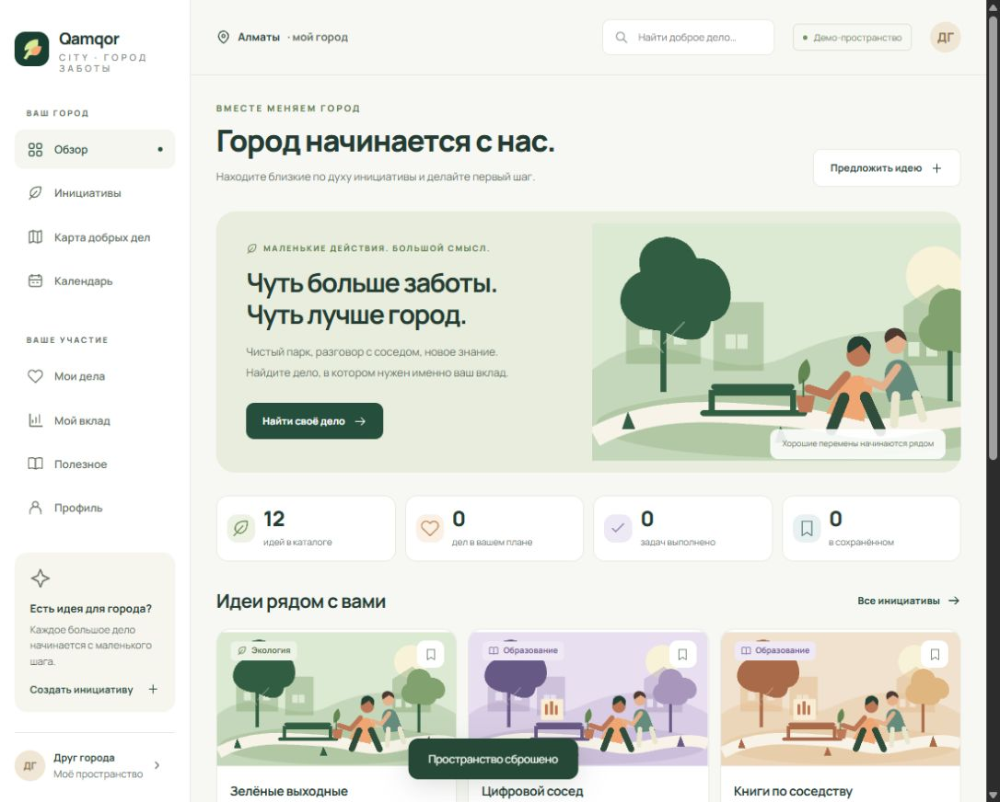

# Qamqor City

**A civic participation workspace for small, meaningful steps.**

Qamqor City is a complete, browser-local web application that helps people explore community initiatives, plan participation, record personal tasks, and understand their own progress. Its Russian interface is designed around an illustrative Almaty context and a warm botanical visual identity.

This repository is a working product prototype, not a live volunteering network. All 12 supplied initiatives are explicitly labelled examples. No real organizers, partner organizations, attendance, or social outcomes are claimed.



## Run in one minute

Requires **Node.js 22 or newer**. There are no npm dependencies and no installation step.

```sh
npm start
```

Open **http://127.0.0.1:4174**. On Windows, you can also double-click `RUN.cmd`; keep its terminal window open while using the app. If a browser tab opens before the server starts, refresh once.

```sh
npm test
npm run check
```

[Русская инструкция](docs/START_RU.md) · [Architecture](docs/ARCHITECTURE.md) · [Demo walkthrough](docs/DEMO.md) · [Roadmap](docs/ROADMAP.md)

## Product experience

| Area | Working functionality |
| --- | --- |
| Overview | Personal derived counts, featured initiatives, sample event schedule, progress summary |
| Initiatives | 12 substantial examples across 4 categories and 8 districts; combined search and filters; persistent bookmarks |
| Initiative detail | Description, preparation guidance, date/time, local participation, a real interactive task checklist |
| Schematic map | Filterable interactive markers and selected initiative cards; explicitly illustrative geography |
| Calendar | Month navigation, day filtering, dated initiative links, empty states |
| Create an initiative | Field validation, live card preview, persistent local creation, automatic personal task template |
| My participation | Joined, saved, and created views; task completion; autosaved personal notes |
| Personal impact | Category chart, completion ring, derived achievements, explicit explanation of every metric |
| Resource library | Six structured guides on participation, safety, inclusion, planning, digital help, and measurement |
| Profile and data | Local name/district, JSON export, validated import, confirmation before destructive reset |

Additional details include keyboard focus treatment, skip navigation, dialogue focus trapping, reduced-motion support, mobile navigation, responsive layouts, real empty states, and unknown-route handling. The UI uses original inline SVG illustrations rather than remote placeholder images.

## A useful five-minute demonstration

1. Open **Инициативы** and filter by **Экология**.
2. Open **Зелёные выходные**, save it, and select **Добавить в мой план**.
3. Complete one preparation task and add a reflection under **Мои дела**.
4. Open **Мой вклад**; the chart, percentage and first-step achievement update from your actual local state.
5. Create a new initiative and watch the card preview update while you type.
6. Find your idea in the catalog and calendar. Export a backup from your profile.
7. Refresh the browser to demonstrate persistence.

## Architecture

The app uses native JavaScript ES modules, semantic HTML, and CSS. The complete deployable application lives in `dist/`; the name describes a static hosting directory, not generated or minified output. There is intentionally no bundler, framework dependency, database, or build pipeline to install.

```text
dist/
  index.html       Accessible application entry
  app.js           Hash routes, views, UI events, persistence boundary
  domain.js        Pure state transitions, validation, metrics, import safety
  data.js          Clearly labelled sample initiatives and learning guides
  visuals.js       Original SVG illustrations and icon system
  styles.css       Responsive component styles and design tokens
scripts/serve.mjs   Loopback-only static development server
tests/             Node test runner: invariants, adversarial imports, derived metrics
docs/              Architecture, Russian start guide, demo script, roadmap
```

Pure domain operations make meaningful behavior testable without emulating the interface. Joining is idempotent; task completion requires membership in the corresponding initiative; import reconstructs an allowlisted schema instead of merging arbitrary objects. User-provided text is escaped at HTML output boundaries.

## Data and privacy

- The app stores one versioned JSON document in browser `localStorage` under `qamqor-city-v1`.
- Names, notes, saved initiatives, and personal plans stay in the browser on that origin. There is no login, API, analytics, message delivery, or cloud synchronization.
- JSON backups contain the user's notes and name; keep them where you keep other personal files. Import is size limited and validated before a replacement confirmation.
- Google Fonts supplies Manrope when an internet connection is available. The interface falls back to system fonts; functional application assets are served locally.
- Private browsing, clearing browser data, changing hostname/port, or another browser can create a separate or temporary space. Export before moving between environments.

## Scope and limitations

This is a polished, single-user MVP for a civic product concept. It does not submit registrations, verify attendance, contact organizers, host public proposals, or certify volunteer hours. The map is a schematic illustration. Calendar dates are fixed example planning data for October–November 2026. Planned durations are not measured volunteering time. Achievement badges are calculated from local actions only.

The interface is Russian and uses a limited example geography. Native browser dates may be rendered according to operating-system preferences. The local server is for development and binds to `127.0.0.1`; production hosting should serve `dist/` over HTTPS. Hash routes need no server rewrite rules, and relative asset paths also support a repository subpath.

## Quality and verification

`npm test` checks state immutability, idempotent joins, task ownership, derived completion and removal, multi-filter search, valid calendar dates, unsafe import rejection, backup normalization, prototype-key rejection, HTML escaping, and seed consistency. `npm run check` validates module syntax. CI runs both on Node.js 22.

Manual review should cover desktop and narrow mobile layouts, the form-to-catalog workflow, keyboard navigation, local persistence, JSON backup round trips, and empty states. Automated domain tests are not a claim of a full accessibility or production-security audit.

## Provenance and contribution

This implementation, sample content, and SVG artwork were prepared with AI assistance. The repository makes no claim of completed field research, existing community partners, deployed civic programs, or independently verified impact. Future portfolio work should document real design decisions, user feedback, authorized field pilots, validation and the author's own changes in the commit history.

Contributions can improve content, accessibility, localization, and domain behavior. Keep sample and real data clearly separated, explain behavioral changes, and run the existing checks. See [the roadmap](docs/ROADMAP.md) for a practical sequence toward a real service.

## License

MIT. See [LICENSE](LICENSE).
